# Diseño de interfaz de usuario

La aplicación tendrá la siguientes pantallas

1. Pantalla 1: Pantalla de Inicio

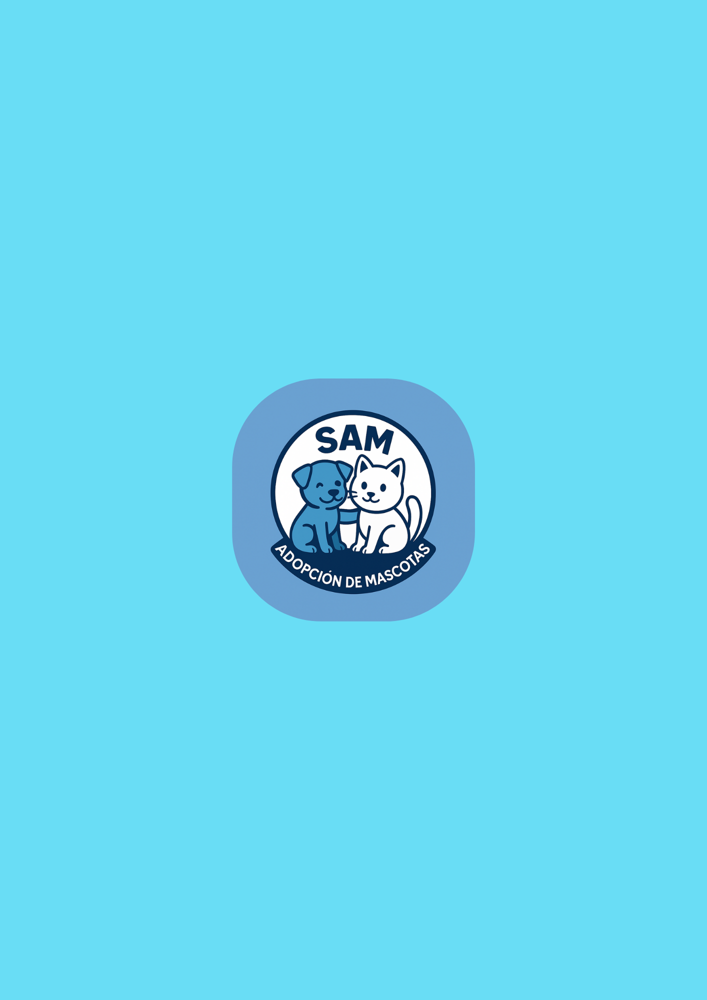

2. Pantalla 2: Login

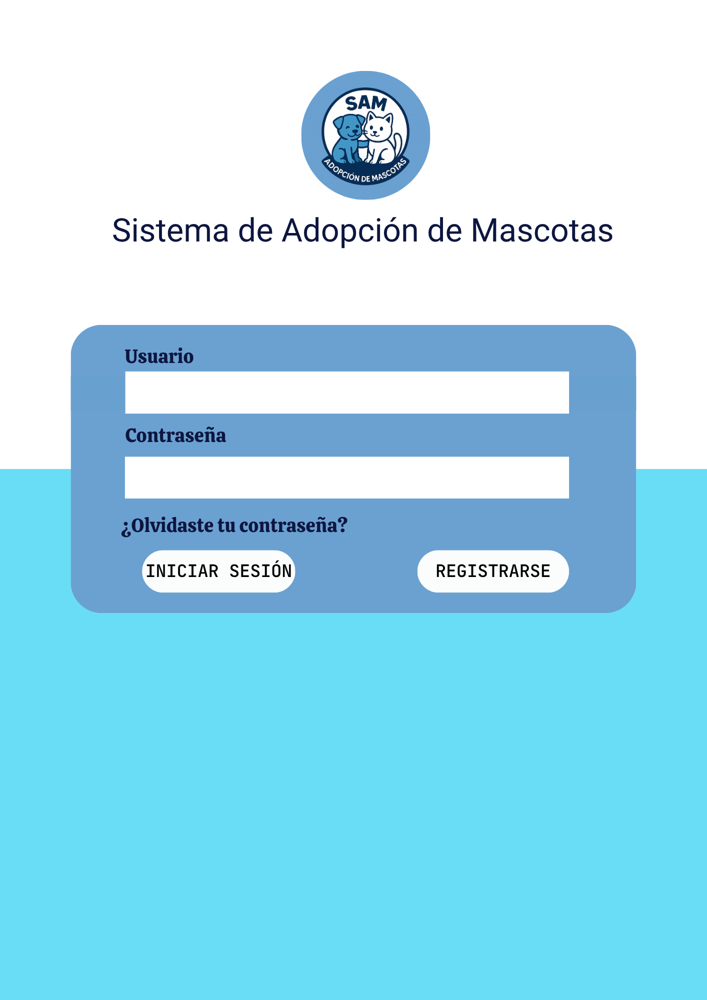

3. Pantalla 3: Registro de Cuenta - 1

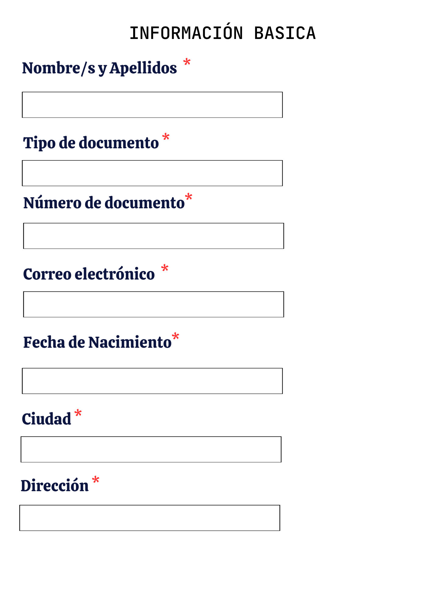

4. Pantalla 4: Registro de Cuenta - 2

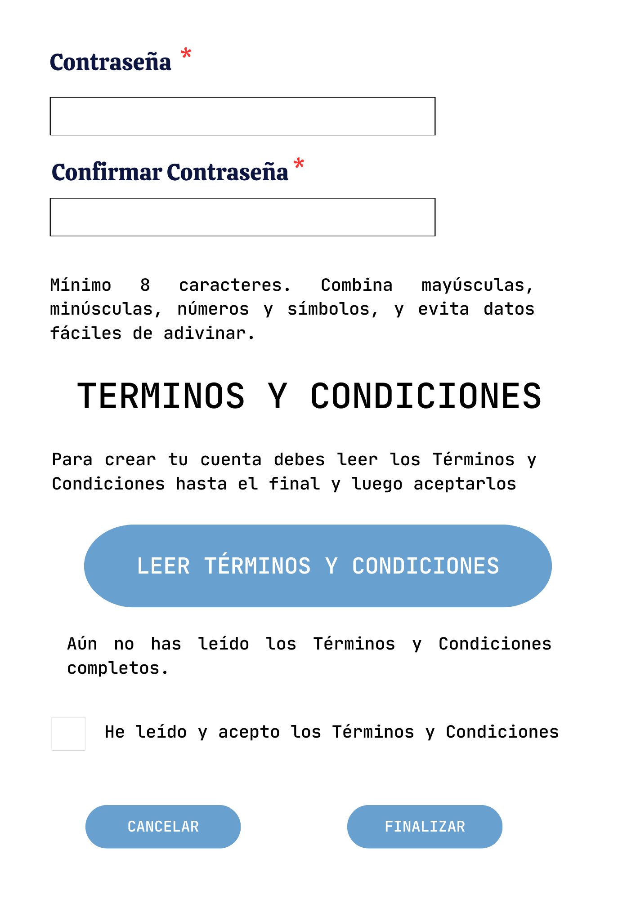

5. Pantalla 5: Términos y Condiciones SAM APP

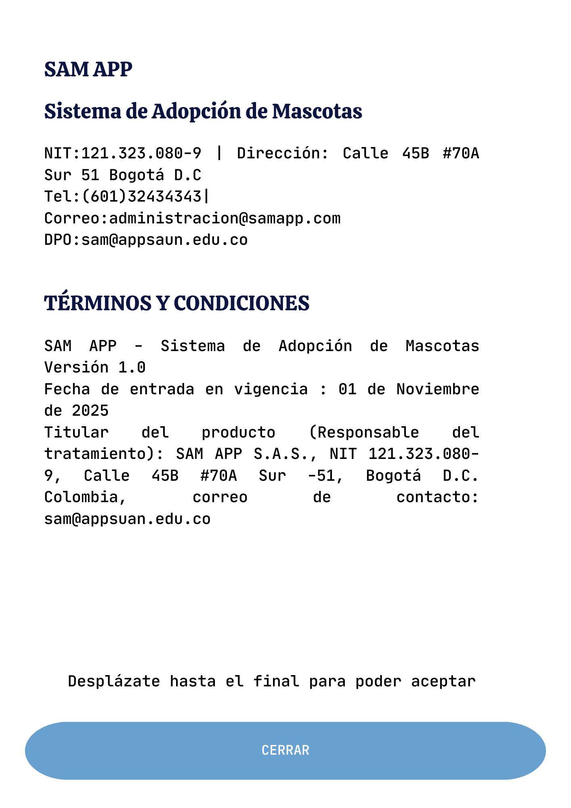

6. Pantalla 6: Interfaz de Recuperación de Contraseña

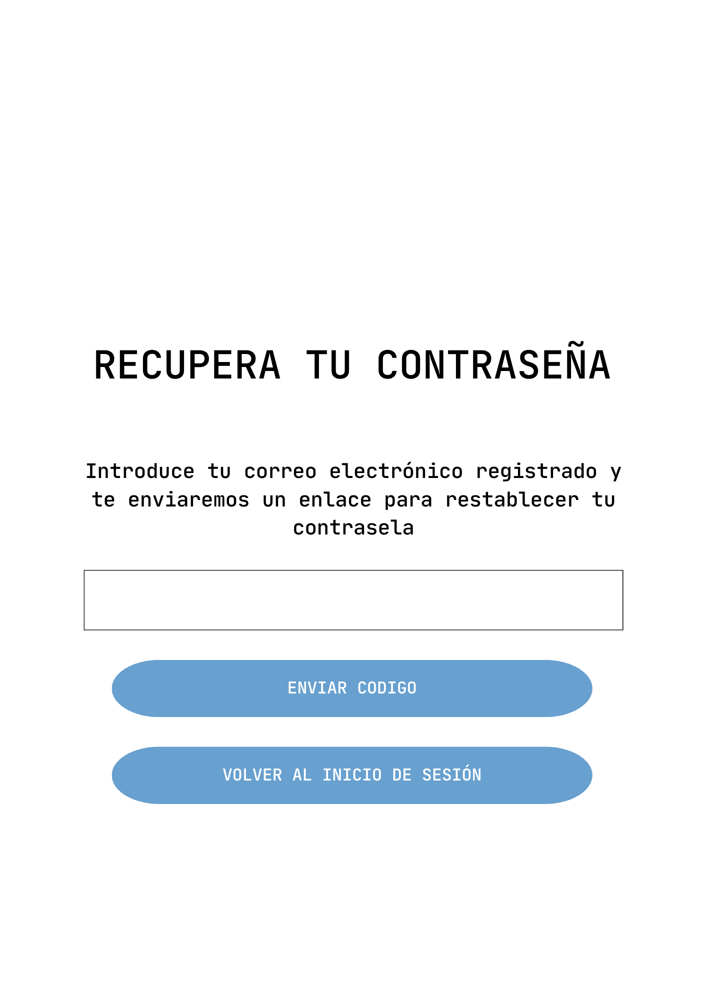

7. Pantalla 7: Confirmación de Envío de Correo Para Modificación de la Contraseña

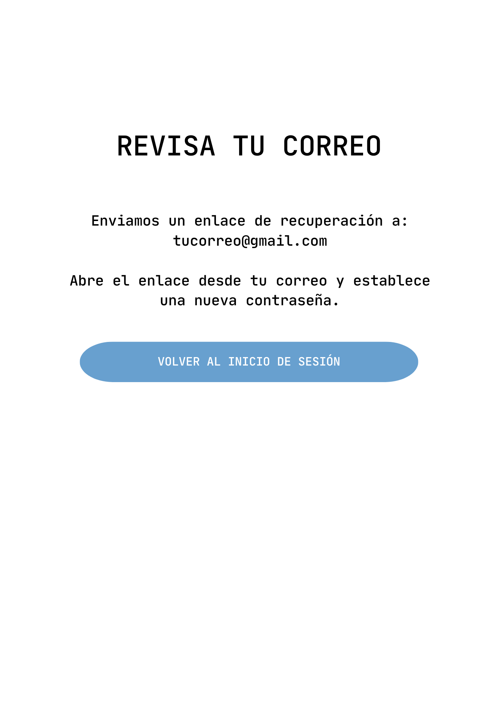

8. Pantalla 8: Interfaz de Bienvenida

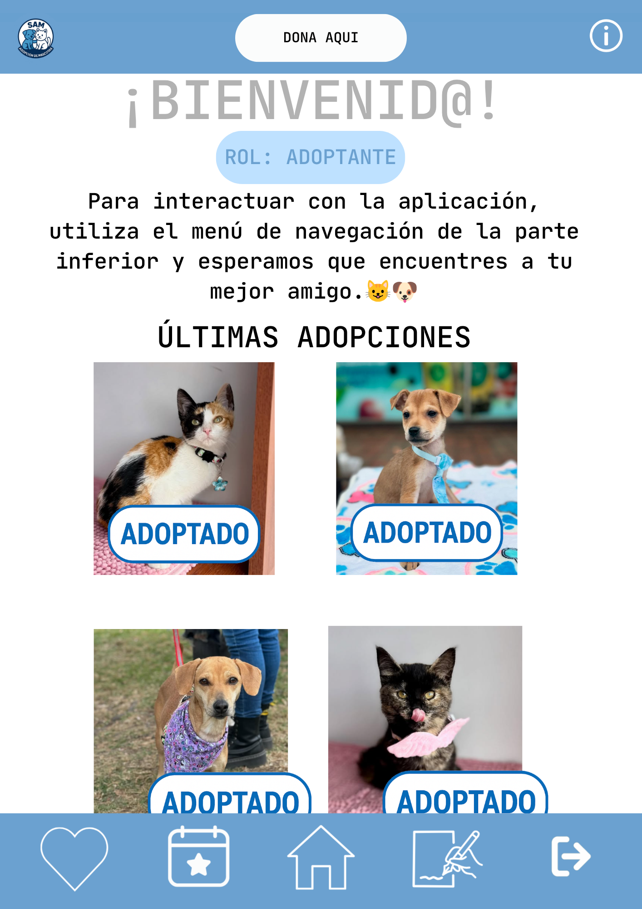

9. Pantalla 9: Interfaz de Adopciones

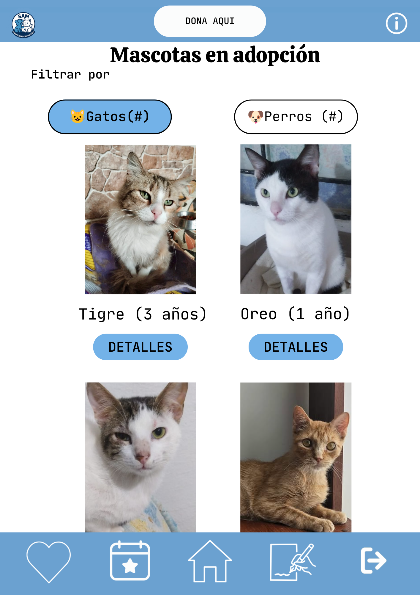

10. Pantalla 10: Interfaz Información Mascota

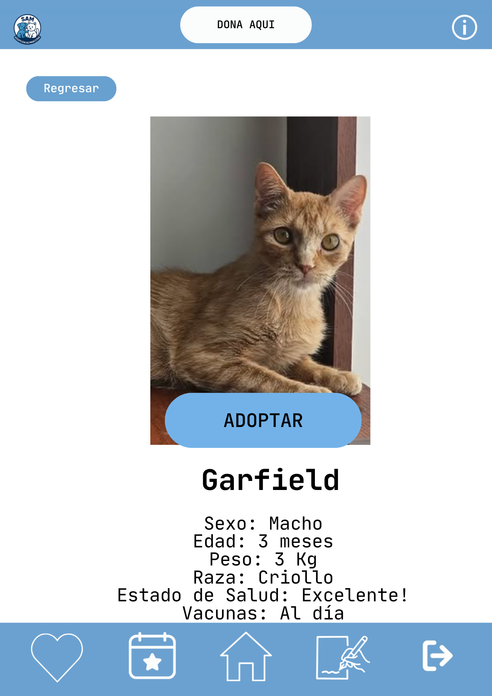

11. Pantalla 11: Interfaz Eventos

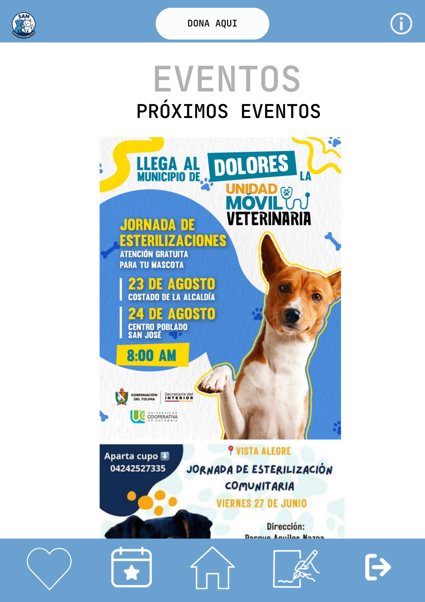

12. Pantalla 12: Interfaz Donación

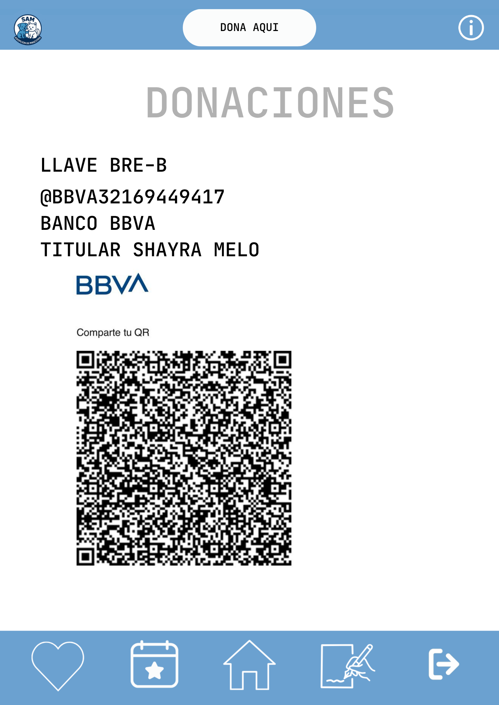

13. Pantalla 14: Interfaz Información SAM APP

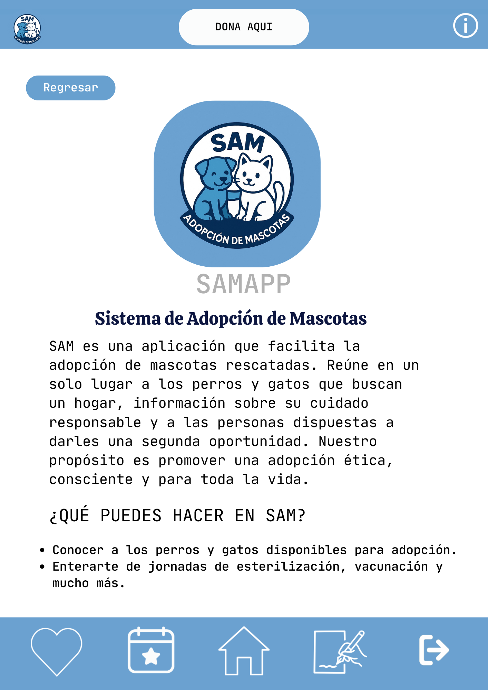

14. Pantalla 15: Interfaz Cerrar Sesión

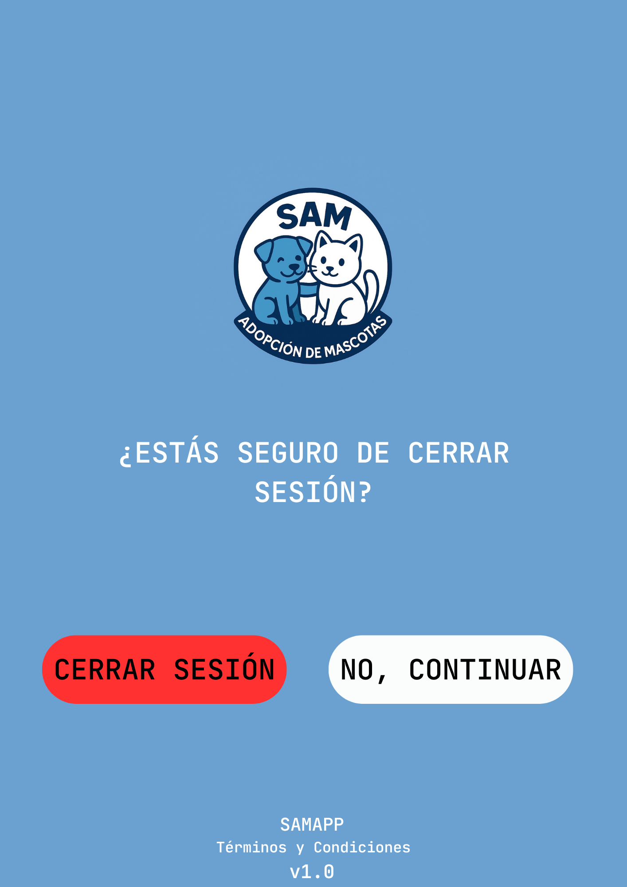

# Referencias

- [Material Design: Foundations](https://m3.material.io/foundations)
- [Material Design: Style](https://m3.material.io/styles)